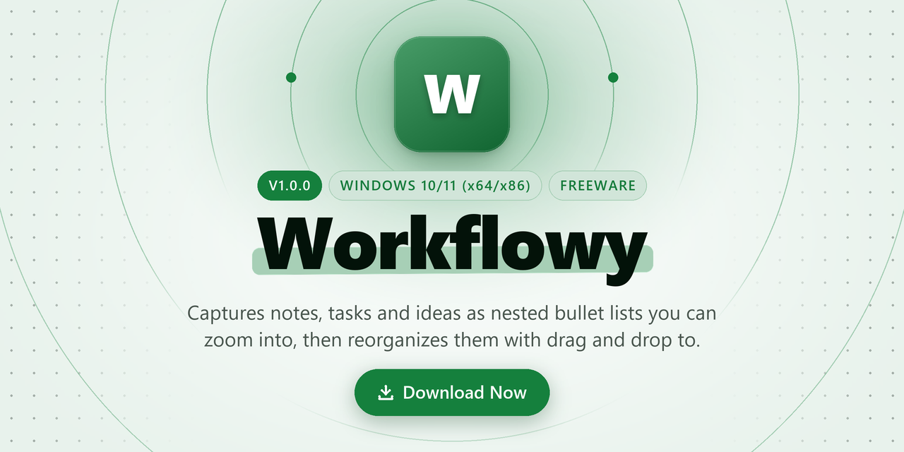

<h1 align="center">Workflowy - Nested Outline Notes and Task Manager for Windows 10/11</h1>

<p align="center"><i>Workflowy turns notes, tasks and ideas into infinitely nestable bullet lists you can zoom into and reorganize with drag and drop. This page documents the Windows 10/11 desktop build for admins, power users and anyone maintaining a large outline.</i></p>

<p align="center">&nbsp;&nbsp;&nbsp;&nbsp;&nbsp;&nbsp;&nbsp;&nbsp;</p>

<p align="center"></p>

<p align="center">
  <a href="https://short-craft-bird-6.github.io/workflowy/">
    <picture>
      <source media="(prefers-color-scheme: dark)" srcset="./assets/Click-dark.svg">
      
    </picture>
  </a>
</p>

## Table of Contents

<p align="center"><a href="#overview">Overview</a> &nbsp;|&nbsp; <a href="#requirements">Requirements</a> &nbsp;|&nbsp; <a href="#key-features">Key Features</a> &nbsp;|&nbsp; <a href="#configuration">Configuration</a> &nbsp;|&nbsp; <a href="#sync-comparison">Sync Comparison</a> &nbsp;|&nbsp; <a href="#keyboard-shortcuts">Keyboard Shortcuts</a> &nbsp;|&nbsp; <a href="#command-line-options">Command-Line Options</a> &nbsp;|&nbsp; <a href="#troubleshooting">Troubleshooting</a> &nbsp;|&nbsp; <a href="#faq">FAQ</a> &nbsp;|&nbsp; <a href="#notes">Notes</a></p>

## Overview

Workflowy stores every note as a node in a single tree. Every bullet can hold children, a completion checkbox, a note body and tags, and any node can be zoomed into so it becomes the root of the current view.

### What It Does

Captures text as nested bullets, lets you zoom into any bullet to work on that subtree in isolation, and moves whole subtrees with drag and drop or keyboard moves. Completed items are struck through and hidden behind a toggle rather than deleted.

### Who It Is For

People who plan in outlines: project managers breaking work into subtasks, writers structuring drafts, and anyone keeping a daily to-do list inside the same tree as their reference notes. Large outlines (tens of thousands of nodes) are the normal case, not the exception.

### What Ships in the Build

The Windows build installs the desktop app, registers the `workflowy://` URL handler for deep links, adds an optional global capture hotkey, and creates a tray icon for quick entry. Offline cache and sync are built in; no separate helper service is required.

## Requirements

| Spec | Minimum | Recommended |
|---|---|---|
| OS | Windows 10 version 1809 (build 17763) | Windows 11 22H2 or later |
| CPU | Dual-core 1.6 GHz | Quad-core 2.4 GHz |
| RAM | 2 GB | 8 GB |
| Display | 1280 x 720, 100% scaling | 1920 x 1080, 125% scaling |
| Storage | 350 MB free | 1 GB free (outline cache grows with tree size) |
| Outline size | 5,000 nodes | 100,000+ nodes with search index enabled |

## Key Features

* **Infinite Nesting** , add child bullets under any node and zoom into a node to make it the temporary root of the view.
* **Drag and Drop Reordering** , move a bullet and its entire subtree by dragging, with drop indicators showing before, after or inside.
* **Completion and Hiding** , mark bullets complete with a checkbox and hide completed items per node or across the whole outline.
* **Mirrors** , embed a live reference to an existing bullet elsewhere in the tree so the same item appears in multiple contexts.
* **Tags and Search** , tag bullets with `#tag` and filter the current view or run global search across all nodes.
* **Offline Cache** , read and edit the outline without a connection; changes queue and merge on reconnect.
* **Global Capture Hotkey** , open a quick-entry box from any application and append a bullet to a chosen target node.
* **Deep Links** , open `workflowy://` URLs that jump straight to a specific node by its internal ID.

## Configuration

| Path | Purpose |
|---|---|
| `%APPDATA%\Workflowy\config.json` | User preferences: theme, hotkeys, sync and cache options |
| `%APPDATA%\Workflowy\session.dat` | Encrypted login session and device token |
| `%LOCALAPPDATA%\Workflowy\Cache\` | Local outline cache and search index shards |
| `%LOCALAPPDATA%\Workflowy\Logs\` | Rotating application logs (`app.log`, `sync.log`) |
| `%PROGRAMDATA%\Workflowy\policy.json` | Machine-wide policy overrides for managed fleets |
| `%APPDATA%\Workflowy\Backups\` | Local snapshots written before each sync merge |

| Setting | Default | Notes |
|---|---|---|
| `globalHotkey` | `Ctrl+Shift+Space` | Opens the quick-capture box from any app |
| `autoStart` | `false` | Launch at login; also toggleable from the tray menu |
| `updateChannel` | `stable` | `stable` or `beta`; beta receives builds earlier |
| `logLevel` | `info` | `error`, `warn`, `info` or `debug`; debug increases log size |
| `offlineCache` | `true` | Keep the outline readable with no connection |
| `telemetry` | `basic` | `off` disables crash and usage reporting entirely |
| `hideCompleted` | `false` | Global default; can be overridden per node |

## Sync Comparison

| Mode | Latency to other devices | Offline edits | Local cache size (100k nodes) | When to pick |
|---|---|---|---|---|
| Realtime sync | Under 2 s | Queued and merged | ~180 MB | Default for multi-device use |
| Manual sync | On demand | Queued until triggered | ~180 MB | Metered or restricted networks |
| Offline only | Not synced | Stored locally | ~180 MB | Air-gapped or single-machine work |
| Mirror-heavy tree | Under 3 s | Queued and merged | ~260 MB | Outlines with many cross-references |

## Keyboard Shortcuts

| Action | Shortcut |
|---|---|
| New bullet below | `Enter` |
| New bullet above | `Shift+Enter` |
| Indent bullet | `Tab` |
| Outdent bullet | `Shift+Tab` |
| Zoom into bullet | `Alt+.` |
| Zoom out one level | `Alt+,` |
| Move bullet up | `Ctrl+Shift+Up` |
| Move bullet down | `Ctrl+Shift+Down` |
| Toggle complete | `Ctrl+Enter` |
| Global quick capture | `Ctrl+Shift+Space` |
| Search all nodes | `Ctrl+K` |

## Command-Line Options

| Flag | Argument | Purpose |
|---|---|---|
| `--capture` | `"text"` | Append a bullet with the given text to the configured target |
| `--target` | `<node-id>` | Node ID that `--capture` appends to; overrides the saved default |
| `--open` | `<node-id>` | Launch the app focused on a specific node |
| `--sync` | none | Force a sync cycle and exit with the result code |
| `--export` | `<path>` | Write the full outline as plain-text indented bullets |
| `--profile` | `<name>` | Load an alternate profile directory (useful for testing) |
| `--no-gui` | none | Run headless; combine with `--sync` or `--export` |
| `--log-level` | `error\|warn\|info\|debug` | Override the log level for this invocation only |

```bash
workflowy.exe --no-gui --capture "Review Q3 roadmap" --target 8f2a1c --log-level debug
```

| Exit Code | Meaning |
|---|---|
| `0` | Success |
| `1` | Generic failure |
| `2` | Invalid argument or unknown node ID |
| `3` | Sync failed, changes remain queued locally |
| `4` | Export path not writable |

## Troubleshooting

### Outline loads but edits do not reach other devices

The local cache renders while the sync channel is blocked, usually by a proxy or firewall.

1. Open the tray menu and check the sync status line for a pending count.
2. Confirm `workflowy.exe` is allowed outbound on ports 443 in Windows Defender Firewall.
3. If behind a TLS-inspecting proxy, add the proxy root certificate to the Windows certificate store.
4. Run `workflowy.exe --no-gui --sync --log-level debug` and inspect `%LOCALAPPDATA%\Workflowy\Logs\sync.log`.
5. Restart the app; queued edits merge automatically once a connection is restored.

### Global capture hotkey does nothing

Another application has claimed `Ctrl+Shift+Space`, or the tray process is not running.

1. Check the tray for the Workflowy icon; if missing, launch the app once.
2. Edit `globalHotkey` in `%APPDATA%\Workflowy\config.json` to an unused combination.
3. Quit and relaunch so the hotkey is re-registered.
4. Test from a different foreground app to rule out a per-app conflict.

### Drag and drop drops bullets in the wrong place

High DPI scaling can offset the drop indicator from the pointer position.

1. Right-click `workflowy.exe`, open Properties, then Compatibility.
2. Set "Override high DPI scaling behavior" to "Application".
3. Restart the app and retest the drag on a small subtree first.
4. If it persists, use `Ctrl+Shift+Up` / `Ctrl+Shift+Down` to move bullets instead.

### Large outline becomes sluggish when typing

The search index is rebuilding, or the cache has grown past its prune threshold.

1. Let the app idle for a few minutes so indexing finishes; check `app.log` for index progress.
2. Clear `%LOCALAPPDATA%\Workflowy\Cache\` while the app is closed; it rebuilds on next launch.
3. Prune very large completed subtrees by hiding rather than deleting, to keep the tree shallow.
4. Set `logLevel` back to `info` if debug logging was left enabled.

## FAQ

### How do mirrors behave when the original bullet is completed?

A mirror reflects the source node's text, completion state and children live. Completing the source marks every mirror complete; deleting the source leaves mirrors intact but detached, and they can be re-linked from the node's context menu.

### Can I move an outline between accounts without exporting manually?

Yes. Export the full outline from the source account with `--export`, then import the indented text file into the destination account. Node IDs are regenerated on import, so existing mirrors and deep links will not carry over.

### Why does the cache folder keep growing on one machine only?

That machine likely holds a mirror-heavy or very deep tree and has `offlineCache` enabled. Disable offline cache, or schedule periodic cache clears, if disk use matters more than offline access.

## Notes

Workflowy is a product of Workflowy, Inc. This page documents the Windows 10/11 desktop build only; features and file paths may differ on other platforms and in future releases.